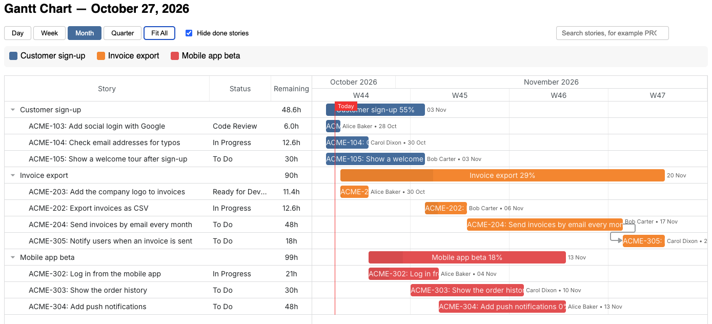

# jira-smurf



A command line tool for Jira Cloud. It can:

- export all stories of a project as CSV or as an HTML table, grouped by epic;
- plan a set of stories over your team and write an interactive Gantt chart.

## Setup

You need Python 3.9 or newer.

```bash
pip install -r requirements.txt
cp .env.example .env
cp gantt.example.toml gantt.toml   # only for the Gantt chart
```

Put your values in `.env`:

| Variable                  | Description                                                                                                                        |
| ------------------------- | ---------------------------------------------------------------------------------------------------------------------------------- |
| `JIRA_URL`                | Your Jira Cloud URL, for example `https://yourorg.atlassian.net`                                                                   |
| `JIRA_EMAIL`              | Your Atlassian account email                                                                                                       |
| `JIRA_API_TOKEN`          | API token from [Atlassian API tokens](https://id.atlassian.com/manage-profile/security/api-tokens)                                 |
| `JIRA_PROJECT`            | Project key, for example `PROJ`                                                                                                    |
| `JIRA_STORY_POINTS_FIELD` | _(Optional)_ Field name for story points. The default is `story_points`. The tool also tries `customfield_10028`.                  |
| `JIRA_SPRINT_FIELD`       | _(Optional)_ Field name for the sprint. The default is `customfield_10020`.                                                        |
| `JIRA_EXCLUDE_STATUSES`   | _(Optional)_ Comma-separated statuses to leave out of the CSV and HTML export, for example `Done,Cancelled`. Case does not matter. |
| `JIRA_HIGHLIGHT_RULES`    | _(Optional)_ Row colours for the HTML export, for example `Assignee=Alice:yellow\|Status=Blocked:#ffcccc`.                         |

`.env` and `gantt.toml` are in `.gitignore`, so your token and your team stay out of git.

## Usage

```bash
python jira_smurf.py csv                        # CSV to standard output
python jira_smurf.py csv -o stories.csv         # CSV to a file
python jira_smurf.py html -o stories.html       # HTML table
python jira_smurf.py gantt -o gantt.html        # Gantt chart, uses gantt.toml
python jira_smurf.py gantt -c other.toml -o gantt.html
python jira_smurf.py gantt -o gantt.html --history plannings                    # also show changes and trend
python jira_smurf.py gantt -o gantt.html --history plannings --since 2026-10-01
python jira_smurf.py fields                     # find the story points field
python jira_smurf.py --help
```

`./generate-gantt.sh` writes the chart to `plannings/gantt-YYYY-MM-DD.html` and opens it. It uses `--history plannings`, and it passes extra arguments such as `--since 2026-10-01` to the `gantt` command. It uses `open`, so it works on macOS.

Progress messages go to standard error, so they do not end up in the output.

## Example CSV output

```
Epic;Sprint;Story ID;Title;Points;Status;Assignee
Authentication;Sprint 5;PROJ-12;Add login page;3;In Progress;Alice
Authentication;Sprint 6;PROJ-15;Add password reset flow;5;To Do;Bob
Search;Sprint 5;PROJ-20;Implement full-text search;8;In Progress;Alice
(No Epic);;PROJ-31;Fix header alignment;1;To Do;Unassigned
```

## Gantt chart

The `gantt` command reads `gantt.toml`. See [`gantt.example.toml`](gantt.example.toml) for a full example.

| Setting                  | Description                                                                                            |
| ------------------------ | ------------------------------------------------------------------------------------------------------ |
| `start_date`             | First day of the planning, `YYYY-MM-DD`.                                                               |
| `default_hours`          | Hours for a story without story points.                                                                |
| `velocity`               | Hours per story point.                                                                                 |
| `include_open_sprints`   | `true` also adds all stories in the active sprint.                                                     |
| `include_future_sprints` | `true` also adds all stories in future sprints.                                                        |
| `holidays`               | This is a list of days off for the whole team, for example `["2026-12-25", "2026-12-26"]`.            |
| `[team."Name"]`          | Hours per weekday (`mon` to `fri`) for each team member. The name must match the display name in Jira. |
| `auto_assign`            | Per team member. `false` means the member gets no unassigned stories. Such a member may have no hours. |
| `days_off`               | This is set per team member. It is a list of days off, for example `["2026-12-10", "2026-12-18 to 2027-01-01"]`. A range includes both days. No work is planned on those days. |
| `[statuses]`             | Progress in percent for each Jira status. A story at 100 is done.                                      |
| `[status_colors]`        | This sets a row background color for each Jira status, for example `"Blocked" = "#ffcccc"`.      |
| `[epics.KEY]`            | Plan all stories of this epic.                                                                         |
| `[stories.KEY]`          | Plan this story. `depends_on = ["KEY"]` makes it start after the listed stories finish.                |

How the planning works:

- Stories are planned in the order of the file: epics first, then single stories, then sprint stories.
- A story assigned in Jira to a team member goes to that member. Other stories go to the auto-assign member who is free first.
- Remaining work is the estimate times (1 minus the progress of the status).
- Stories that are not done start on today's date at the earliest.

In the chart you can zoom, search for a story and hide done stories. Click a bar to open the story in Jira.
The buttons in the Story column header collapse or expand all epics.
In the day view, weekends and holidays have a gray background.

### Changes and trend

With `--history DIR`, each run stores its plan in `DIR/plan-YYYY-MM-DD.json`. A second run on the same day replaces that file. The chart then compares the plan with an earlier snapshot, the baseline. The baseline is the latest snapshot before the current day. With `--since YYYY-MM-DD`, it is the latest snapshot on or before that date.

The checkbox "Show changes since …" in the toolbar turns these marks on and off:

- A new story has a yellow row and a red NEW in the Moved column.
- A story with a changed estimate shows the change next to its remaining hours, for example `16h +8h`.
- A thin gray bar under a story or epic shows its dates in the baseline.
- The Moved column shows how many working days the end date moved.
- A story that the baseline planned to be done by now, but that is still open, has a red outline.
- Open stories that are no longer in the plan are listed in a gray group at the end of the chart.

Below the chart, a summary shows how far the plan end moved and why: new stories, changed estimates, stories that left the plan and late stories.

With two or more snapshots, a trend chart shows the planned end of each epic at each run. A flat line means the end date did not move. A rising line means it moved later.

## Notes

- The tool works with team-managed projects (epic through `parent`) and company-managed projects (epic through `customfield_10014`).
- Stories without an epic are grouped under "(No Epic)".

## License

[MIT](LICENSE)
