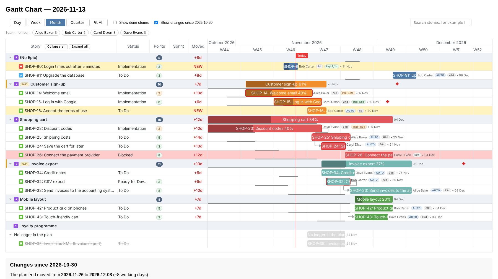

# jira-smurf



A command line tool for Jira Cloud. It can:

- export all stories of a project as CSV or as an HTML table, grouped by epic;
- plan a set of stories over your team and write an interactive Gantt chart.

## Setup

You need Python 3.9 or newer.

```bash
pip install -r requirements.txt
cp .env.example .env
cp gantt.example.toml gantt.toml   # only for the Gantt chart
```

Put your values in `.env`:

| Variable                  | Description                                                                                                                        |
| ------------------------- | ---------------------------------------------------------------------------------------------------------------------------------- |
| `JIRA_URL`                | Your Jira Cloud URL, for example `https://yourorg.atlassian.net`                                                                   |
| `JIRA_EMAIL`              | Your Atlassian account email                                                                                                       |
| `JIRA_API_TOKEN`          | API token from [Atlassian API tokens](https://id.atlassian.com/manage-profile/security/api-tokens)                                 |
| `JIRA_PROJECT`            | Project key, for example `PROJ`                                                                                                    |
| `JIRA_STORY_POINTS_FIELD` | _(Optional)_ Field name for story points. The default is `story_points`. The tool also tries `customfield_10016` (Story point estimate). |
| `JIRA_SPRINT_FIELD`       | _(Optional)_ Field name for the sprint. The default is `customfield_10020`.                                                        |
| `JIRA_EXCLUDE_STATUSES`   | _(Optional)_ Comma-separated statuses to leave out of the CSV and HTML export, for example `Done,Cancelled`. Case does not matter. |
| `JIRA_HIGHLIGHT_RULES`    | _(Optional)_ Row colours for the HTML export, for example `Assignee=Alice:yellow\|Status=Blocked:#ffcccc`.                         |

`.env` and `gantt.toml` are in `.gitignore`, so your token and your team stay out of git.

## Usage

```bash
python jira_smurf.py csv                        # CSV to standard output
python jira_smurf.py csv -o stories.csv         # CSV to a file
python jira_smurf.py html -o stories.html       # HTML table
python jira_smurf.py gantt -o gantt.html        # Gantt chart, uses gantt.toml
python jira_smurf.py gantt -c other.toml -o gantt.html
python jira_smurf.py gantt -o gantt.html --history plannings                    # store a snapshot, show the trend
python jira_smurf.py gantt -o gantt.html --history plannings --since            # also show changes since the last run
python jira_smurf.py gantt -o gantt.html --history plannings --since 2026-10-01 # also show changes since a date
python jira_smurf.py fields                     # find the story points field
python jira_smurf.py velocity                   # measure the hours per story point of the last 8 weeks
python jira_smurf.py velocity --weeks 4
python jira_smurf.py --help
```

`./generate-gantt.sh` writes the chart to `plannings/gantt-YYYY-MM-DD.html` and opens it. It uses
`--history plannings`, and it passes extra arguments such as `--since` or `--since 2026-10-01` to
the `gantt` command. It uses `open`, so it works on macOS. If there is a virtual environment in
`.venv`, the script uses its Python, so you do not have to activate it first.

### Refresh the chart from the browser

```bash
./serve-gantt.sh                                # or: python jira_smurf.py serve --history plannings
python jira_smurf.py serve --port 8080 --no-open
```

`serve` builds the chart, serves it at `http://localhost:8000/` and opens it in the browser. The
page then has a **Refresh from Jira** button: it fetches the stories again, rebuilds the chart and
reloads the page, so you do not have to go back to the command line. Each refresh reads
`gantt.toml` again, so changes to it are picked up too. With `--history`, each refresh also stores
the snapshot and the chart in that directory, like `generate-gantt.sh`. Stop the server with Ctrl+C.

The server only listens on this computer (`127.0.0.1`), because the chart shows Jira data fetched
with your token. A chart opened as a file has no refresh button.

Progress messages go to standard error, so they do not end up in the output.

## Example CSV output

```
Epic;Sprint;Story ID;Title;Points;Status;Assignee
Authentication;Sprint 5;PROJ-12;Add login page;3;In Progress;Alice
Authentication;Sprint 6;PROJ-15;Add password reset flow;5;To Do;Bob
Search;Sprint 5;PROJ-20;Implement full-text search;8;In Progress;Alice
(No Epic);;PROJ-31;Fix header alignment;1;To Do;Unassigned
```

## Gantt chart

The `gantt` command reads `gantt.toml`. See [`gantt.example.toml`](gantt.example.toml) for a full
example.

| Setting                  | Description                                                                                                                                                                    |
| ------------------------ | ------------------------------------------------------------------------------------------------------------------------------------------------------------------------------ |
| `start_date`             | First day of the planning, `YYYY-MM-DD`.                                                                                                                                       |
| `default_hours`          | Hours for a story without story points.                                                                                                                                        |
| `velocity`               | Hours per story point.                                                                                                                                                         |
| `include_open_sprints`   | `true` also adds all stories in the active sprint.                                                                                                                             |
| `include_future_sprints` | `true` also adds all stories in future sprints.                                                                                                                                |
| `dependency_links`       | This is the list of Jira link types that work as dependencies. The default is `["Blocks"]`. A story that "is blocked by" another story starts after that story is finished. A type in this list must work like Blocks. Use `[]` to ignore Jira links. |
| `use_backlog_order`      | `true` plans the stories in the order of the Jira backlog, and orders the epic rows of the chart by their rank in Jira.                                                        |
| `auto_assign`            | `false` gives no stories to team members that are not assigned to them in Jira. Such stories are planned one after another under "Unassigned", 8 hours a day. The default is `true`. |
| `work_starts_at`         | This is the status where work on a story starts, for example `"In Progress"`. A done story's bar starts on the first change to this status, or to a status with more progress. |
| `implementation_status`  | This setting is optional. It is a status from `[statuses]`, for example `"Implementation"`. An open story that is at this status or a later one gets a badge such as `impl 3/2d`: the working days since it started in exactly this status, and its estimate in working days of 8 hours. |
| `holidays`               | This is a list of days off for the whole team, for example `["2026-12-25", "2026-12-26"]`.                                                                                     |
| `[team."Name"]`          | Hours per weekday (`mon` to `fri`) for each team member. The name must match the display name in Jira.                                                                         |
| `auto_assign`            | Per team member. `false` means the member gets no unassigned stories. Such a member may have no hours. This has no effect when the top-level `auto_assign` is `false`.                                                                       |
| `days_off`               | This is set per team member. It is a list of days off, for example `["2026-12-10", "2026-12-18 to 2027-01-01"]`. A range includes both days. No work is planned on those days. |
| `[statuses]`             | Progress in percent for each Jira status. A story at 100 is done.                                                                                                              |
| `[status_colors]`        | This sets a row background color for each Jira status, for example `"Blocked" = "#ffcccc"`.                                                                                    |
| `[epics.KEY]`            | Plan all stories of this epic.                                                                                                                                                 |
| `[stories.KEY]`          | Plan this story. `depends_on = ["KEY"]` makes it start after the listed stories finish.                                                                                        |

How the planning works:

- Stories are planned in the order of the file: epics first, then single stories, then sprint
  stories. With `use_backlog_order = true`, they are planned in the order of the Jira backlog, and
  the epic rows of the chart follow the rank of the epics in Jira, with stories without an epic
  last. Otherwise the epic rows follow the order of the file. The Rank column shows the position
  of each story in the Jira backlog, among the stories of the plan (1 is the highest).
- Before that order, the planner groups the stories by their status in `[statuses]`: first done
  stories (100), then started stories (at least the value of `work_starts_at`, or above 0 without
  it), then stories in the active sprint, then all other stories. So work that is already started
  or planned in the sprint is planned before backlog stories, even when those rank higher in Jira.
- A story never starts before the stories in its `depends_on` list are finished. The same holds for stories that block it in Jira, with a link type from `dependency_links`. Both kinds of dependencies have an arrow in the chart. Links to stories that are not in the plan are ignored.
- A story assigned in Jira to a team member goes to that member. Other stories go to the auto-assign
  member who is free first. Such a story has an `AUTO` badge after the name in the chart. With
  `auto_assign = false`, they go to "Unassigned" instead.
- An open story has a grey badge after the name with its age: the number of days since it was
  created in Jira, for example `45d`. Hover over it to see the date. Done stories have no age badge.
- With `implementation_status` set, an open story also has a badge that compares the time in
  implementation with the estimate, for example `impl 3/2d`: 3 working days since it started in that
  status, and an estimate of 2 working days (16 hours at 8 hours a day). Weekends and holidays don't count.
  The badge is green within the estimate and orange over it. Hover over it to see the date and the
  difference. The start is the last move to that status from an earlier status, such as To Do or
  Refinement. So a story that was parked and picked up again starts over, but a story that goes back from
  Code Review for rework keeps its start. This needs one extra Jira call per story that is at that status
  or a later one.
- Remaining work is the estimate times (1 minus the progress of the status).
- With `implementation_status` set, a story that started in that status has already used part of its
  estimate. Its bar starts on that start day, so the days already worked show in the past. From today
  it gets what is left of the estimate after the hours its team member worked since the start, or what
  its status says is left if that is less. A story that is over its estimate gets what its status says
  is left. For example, a 5 point story that started 3 working days ago has 2 days left.
- A story without story points gets `default_hours`. Hover over its bar to see that it has no estimate.
- The duration of an epic depends only on its stories. The epic starts with its first story and ends
  with its last story. Story
  points set on the epic itself are ignored.
- An epic without stories is shown as a striped bar from its Start date to its Due date in Jira, so
  you can plan a roadmap. The planner does not reserve team hours for it. An epic without stories
  and without these dates is skipped. The tool finds the Start date field by its name.
- Stories that are not done start on today's date at the earliest, except for the days already worked
  on a story in the implementation status.
- A done story is placed from its Jira status history. It starts on the first change to the
  `work_starts_at` status or a status with more progress. Without `work_starts_at`, it starts on the
  first change to a status with progress above 0. It ends on the last change to a status at 100. A
  done story without such a change is placed at the start of the plan.

In the chart you can zoom, search for a story and show or hide done stories. Done stories are hidden
at first. Click a team member badge above the table to show only the stories of that member. You can
select more than one member, and "Unassigned". The epic rows then show the points of the stories
that are shown. The Points and Sprint columns show the story points and the number of
the last sprint of each story. Click a bar to open the story in Jira. The buttons in the Story column header collapse or
expand all epics. Each title in the Story column starts with the icon of its Jira issue type. The
run downloads these icons from Jira and puts them in the page, so the page shows them without a Jira
login. If an icon cannot be downloaded, the page shows an emoji instead: 📖 epic, 🔖 story, 🐛 bug,
🔧 task, 🔩 sub-task, 🔬 spike, 📈 improvement, ✨ feature, 🎯 initiative, 🧪 test, 🚨 incident, 🛟
support request, 🧹 technical debt and 📄 any other type. In the day view, weekends and holidays
have a gray background. When a story or epic has a due date in Jira, the chart shows a red diamond
on its row. The diamond is at the end of the due date. The bar of the epic will grow past the due
date according to the planned stories.

### Changes and trend

With `--history DIR`, each run stores its plan in `DIR/plan-YYYY-MM-DD.json`. A second run on the
same day replaces that file.

With `--since`, the chart also compares the plan with an earlier snapshot, the baseline. Without a
date, the baseline is the latest snapshot before the current day. With `--since YYYY-MM-DD`, it is
the latest snapshot on or before that date, or the oldest snapshot if there is none before it. The
run prints a warning when the snapshot is not of that exact date. Without `--since`, the chart shows
no changes.

The checkbox "Show changes since …" in the toolbar turns these marks on and off:

- A new story has a yellow row and a red NEW in the Moved column.
- Hover over a story with a changed estimate to see the change, for example `Estimate: 16h → 24h`.
- A thin gray bar under a story or epic shows its dates in the baseline.
- The Moved column shows how many working days the end date moved.
- A story that the baseline planned to be done by now, but that is still open, has a red outline.
- Open stories that are no longer in the plan are listed in a gray group at the end of the chart.

Below the chart, a summary shows how far the plan end moved and why: new stories, changed estimates,
stories that left the plan and late stories.

With two or more snapshots, a trend chart shows the planned end of each epic at each run. A flat
line means the end date did not move. A rising line means it moved later.

## Measure the velocity

`python jira_smurf.py velocity` measures the real hours per story point of your team. It looks at
the last 8 full weeks, Monday to Sunday, without the current week. With `--weeks N` it looks at the
last N weeks.

For each week, it adds up:

- the team hours from `gantt.toml`, without days off and holidays;
- the story points of the stories that moved to a done status in that week and are assigned to a
  team member.

The hours divided by the points give the velocity. Use the total as `velocity` in `gantt.toml`. The
weekly numbers show how much it varies.

The result is less exact when the team changed during the period, because `gantt.toml` describes the
team as it is now. All other work, such as meetings and bugs without points, counts in the hours. A
story counts in full in the week it was finished.

## Notes

- Jira has two kinds of projects, and they link a story to its epic in different ways. In a
  team-managed project, the epic is the parent of the story, in the `parent` field. In a
  company-managed project, the epic is in the Epic Link field, `customfield_10014`. The tool reads
  both fields, so it finds the epic of a story in both kinds of project.
- Stories without an epic are grouped under "(No Epic)".

## Tip: share the chart from Google Drive

Google Drive does not show HTML files as web pages. A shared link to the chart shows its source as
text. To share the chart as a web page, serve it with a small Google Apps Script web app:

1. Copy the chart to a Google Drive folder under a fixed name, for example `gantt-latest.html`.
   Replace that file after each run.
2. Open the folder in Google Drive in your browser. The folder ID is the last part of the address,
   after `/folders/`.
3. Go to [script.google.com](https://script.google.com), create a new project and paste this script.
   Fill in the folder ID.

   ```javascript
   // Serves gantt-latest.html from a Google Drive folder as a web page.
   const FOLDER_ID = "PASTE_THE_FOLDER_ID_HERE";

   function doGet() {
     const files = DriveApp.getFolderById(FOLDER_ID).getFilesByName("gantt-latest.html");
     if (!files.hasNext()) {
       return HtmlService.createHtmlOutput("<p>gantt-latest.html was not found in the folder.</p>");
     }
     const html = files.next().getBlob().getDataAsString("UTF-8");
     return HtmlService.createHtmlOutput(html).setTitle("Gantt Chart");
   }
   ```

4. Choose **Deploy → New deployment → Web app**. Set **Execute as** to **User accessing the web
   app**. Set **Who has access** to the people who may see the chart, for example everyone in your
   organization.
5. Share the web app link.

The script reads the file on each visit, so the link always shows the latest chart. With **User
accessing the web app**, a person can only see the chart if they can open the folder in Google
Drive. The first time someone opens the link, Google asks them to allow the script to read their
Drive.

Do not use public HTML viewer websites for this. They need a public link to the file, and the chart
contains your planning.

## License

[MIT](LICENSE)
